# LGWallRecon

**Light-guide inner-wall reconstruction from an entrance-face scan.**
[中文说明](README.zh-CN.md) · [User manual (EN)](docs/manual/LGWallRecon_manual_en.pdf) · [用户手册 (中文)](docs/manual/LGWallRecon_manual_zh.pdf)

Author: Hengne Li (李衡讷), South China Normal University — <Hengne.Li@cern.ch>, <Hengne.Li@m.scnu.edu.cn>

A hollow conical light guide (entrance ⌀17.5 mm, exit ⌀8 mm, 100 mm long, mirror wall) is scanned with a small
diffuse light spot on its entrance face while a PMT reads the exit. An ideal cone responds almost uniformly
(within ±0.2 %); the measured map has structure of several percent. LGWallRecon

1. simulates the guide with a specular ray tracer in which the wall is the CAD cone plus a free-form B-spline
   deviation field (CPU with numba, or GPU with OpenCL at a few 10⁷ rays/s),
2. inverts the measured 100×100-point map for a wall shape that reproduces it,
3. checks itself against Geant4, a reciprocity identity, a closure test and an earlier fit of the same scan, and
4. produces zoomable vector figures and a single-file report page with a live 3-D ray animation.



## Result in one paragraph

A wall is found for which simulation and measurement differ by 0.90 % (RMS) in the inner aperture, against
about 0.8 % point noise (χ²/N = 1.27); an ideal cone leaves 5.4 %. The local unevenness of this wall is small,
13 µm RMS, on top of an axisymmetric narrowing of the bore by 0.1–0.9 mm.
**That wall is not unique**, and two independent pieces of evidence say so.
(1) In a closure test with a known wall the synthetic map is reproduced down to the noise, but the recovered
wall correlates with the true one at only 0.18. The recovery is good (correlation above 0.9) only inside the
roughly 100 combinations of the wall shape that the scan determines best, and these hold about 2 % of the true
deformation; the transition is gradual.
(2) The wall published earlier (before the tracer corrections listed in the manual) still reproduces the
measured scan to 0.92 % with the present tracer, yet its local unevenness correlates with the present wall at
only 0.15 (0.80 in the first 20 mm behind the entrance, none further in) and the two mean profiles are 0.2 mm
RMS apart.
Read the wall figure as *one regularised wall that explains the scan*: it shows that little unevenness is
enough, not what the real surface looks like. Exact numbers are in `results/numbers.json`.



## Quick start

```bash
git clone git@github.com:hengne/LGWallRecon-Claude-Fable52.git && cd LGWallRecon-Claude-Fable52
python3 -m venv .venv && .venv/bin/python -m pip install -r requirements.txt
.venv/bin/python -m pip install -r requirements-gpu.txt    # optional: OpenCL tracer
./run_all.sh                  # self-tests -> aperture -> reconstruction -> figures + report  (~45 min with a GPU)
./run_all.sh --with-checks    # also closure test, reciprocity, free reflectivity and Geant4 (about 2 h more)
```

Outputs: `results/` (figures in `zh/` and `en/`, `wall_delta.csv`, `wall_coeffs.json`, `numbers.json`) and
`docs/LGWallRecon_report_{en,zh}.html` (open in a browser; they work offline).

Requirements: Python ≥ 3.10 with the packages in `requirements.txt`. Optional: an OpenCL GPU with the packages
in `requirements-gpu.txt` (`clinfo` must list the device; otherwise run with `LG_GPU=0`, about twenty times
slower), Geant4 11.x for the cross-check, `node` for the animated-ray SVG. Jobs run through
`tools/run_limited.sh`, which caps memory with a systemd scope and adapts the CPU share to the machine load;
on a system without `systemd-run`, call the Python scripts directly. Any failing step or self-test stops
`run_all.sh`; the report marks a check that was not rerun for the current wall.

## Step by step

All commands run inside `src/`, prefixed with `../tools/run_limited.sh` (abbreviated `R` below).

| Step | Command | What it does |
|---|---|---|
| 1 | `R python edge.py` and `R python edge_spot.py` | entrance centre, radius, ellipticity and light-spot shape from the sharp edge of the scan → `out/edge.npz` |
| 2 | `R ./pipeline.sh data` | the reconstruction chain below → `out/fitB_datab.npz`, `out/final_data.npz` |
| 2a | `stageA.py 10 fix 3.0` | axisymmetric wall profile from the radial response |
| 2b | `refine.py`, `kernel_modes.py` | linear response of the map to every wall coefficient (azimuthal Fourier modes) |
| 2c | `stageB.py` | damped least-squares inversion of the 2-D wall; every step is checked with a full ray trace |
| 2d | `final.py` | high-statistics simulated map, residuals, wall on a fine grid |
| 3 | `R python compare_walls.py ../out/final_data.npz ../results/earlier/wall_coeffs_cb81f08.json` | this wall against the wall of an earlier fit of the same scan |
| 4 | `R ./closure.sh 1` | closure test and resolution study |
| 4a | `R python test_jacobian.py datab ../out/fitB_datab.npz` | linear kernels against exact finite changes of the map |
| 5 | `R python test_reciprocity.py ../out/fitB_datab.npz`, `../g4/run_final.sh ../out/fitB_datab.npz` | self-consistency and Geant4 cross-check |
| 6 | `R ./make_report.sh` | figures, numbers, wall exports, report pages |

The manual documents every script, its options, file formats, how to adapt the toolkit to another light guide,
and troubleshooting.

## Checks

Numbers of the published run (`results/numbers.json`); `./run_all.sh --with-checks` regenerates all of them.

| Check | Result |
|---|---|
| Ideal cone, tracer | area-averaged T = (R₂/R₁)² = 0.2090; point by point +0.23 % (centre) to −0.13 % (rim) |
| Geant4, ideal cone | Geant4 / tracer = 1.0012 ± 0.0011 |
| Geant4, fitted wall (720 000 facets) | Geant4 / tracer = 1.0007 ± 0.0015 |
| GPU against CPU tracer | same transmission per point to rounding error in double precision; single precision: mean difference (−2 ± 3)×10⁻⁶ |
| Reciprocity (flux in → out equals out → in) | ratio 1.003 ± 0.009 |
| Quasi-random sampler, grazing wall hits | self-tests, run first by `run_all.sh` |
| Linear kernels against exact changes of the map | non-axisymmetric smooth deformations: correlation 0.84–0.99; axisymmetric ones poorly (0.44–0.50 for a gentle bump), see `results/checks/` |
| Closure test, map | reproduced down to the noise (χ²/N = 0.95) |
| Closure test, wall | **not recovered**: correlation 0.18; 0.97 / 0.91 / 0.70 inside the 30 / 100 / 150 best-determined shape patterns |
| Two fits of the measured scan | both fit (0.92 % and 0.90 %), **walls differ**: correlation 0.15, mean profiles 0.2 mm RMS apart |
| Free mirror reflectivity | R drifts to 0.96 with χ² 27 against 34 (40 points); degenerate with the profile, not separable with this scan |

## Layout

```
data/      measured scan (CSV) and CAD geometry (STEP)
src/       tracer (lgtrace.py CPU, lgcl.py GPU), reconstruction chain, tests, studies, figure and report builders
g4/        Geant4 cross-check (lgsim.cc)
web/       browser tracer, report template, language tables (i18n/zh.json, i18n/en.json)
tools/     run_limited.sh resource wrapper
results/   figures (zh/, en/), wall tables, numbers; earlier/ holds the wall of the earlier fit
docs/      single-file report pages and the user manuals
```

## Limits

The wall is not unique (see above), and the fit is not a proven optimum (χ²/N = 1.27; earlier fits of the same
scan stopped at 1.48 and 1.31). The azimuthal-mean profile is degenerate with the signal scale, the exit radius
and the mirror reflectivity. The linear kernels that steer the fit are weak for broad smooth shapes, the mean
profile above all, so steps in those directions are found inefficiently and the resolution figures of the
closure test are only indicative there (every step is still verified by a full ray trace). Everything is attributed to geometry (perfect mirror, uniform PMT, Lambertian
source). The ring between r = 8.0 mm and the entrance rim is not fitted; there the measurement lies about 2 %
below the model. The spline grid is 2.5 mm along the axis and 15° in azimuth. To pin down the real wall, add
independent measurements: collimated-beam scans at several angles, angle-resolved readout, a scan from the
exit side, or profilometry.

## Repositories

GitHub (public): <https://github.com/hengne/LGWallRecon-Claude-Fable52> · GitLab (SCNU group): <https://gitlab.cern.ch/SCNU/LGWallRecon-Claude-Fable52>

## License

MIT, see [LICENSE](LICENSE).

## Citing

Hengne Li, *LGWallRecon: light-guide inner-wall reconstruction from an entrance-face scan* (2026).
