# LGWallRecon

**由入口面扫描图反演光导内壁形貌的工具包。**
[English](README.md) · [用户手册 (中文)](docs/manual/LGWallRecon_manual_zh.pdf) · [User manual (EN)](docs/manual/LGWallRecon_manual_en.pdf)

作者：李衡讷（Hengne Li），华南师范大学 — <Hengne.Li@cern.ch>，<Hengne.Li@m.scnu.edu.cn>

一根锥形空心光导（入口 ⌀17.5 mm，出口 ⌀8 mm，长 100 mm，内壁贴反射膜），用小的漫射光斑在入口面上逐点扫描，
出口端用 PMT 读出。理想锥面对每个入射点的响应应当完全相同，而实测的响应图并不平坦。LGWallRecon 做四件事：

1. 用镜面光线追迹模拟光导，壁面 = CAD 锥面 + 一张自由形状的 B 样条偏差场（CPU 用 numba，GPU 用 OpenCL，约 5×10⁷ 条光线/秒）；
2. 由 100×100 点实测图反演出一块能复现它的壁面；
3. 用 Geant4、互易性恒等式和闭合测试检验自己；
4. 输出可缩放的矢量图，以及带三维光线动画的单文件报告网页。



## 一段话的结论

可以找到一块壁面，使模拟与实测在孔径内区只差约 1%（均方根），单点测量噪声约 0.8%；理想锥面则相差 5.4%。
所需的局部起伏很小：发布的这个解里均方根只有 13 µm，叠加在内腔整体偏细的轴对称轮廓上。**但这块壁面不是唯一解。** 用已知壁面做闭合测试时，假扫描图被拟合到噪声水平，
恢复出的壁面与真实壁面的相关系数却只有约 0.1。扫描图只对壁面形状中约 100 种组合足够敏感：在这个"可见子空间"里
恢复得不错（相关系数 0.7–0.97），在它之外什么也得不到。所以壁面图应读作"解释扫描图至少需要的不平整"，
而不是真实内表面的测绘。准确数字见 `results/numbers.json`。



## 快速开始

```bash
git clone git@github.com:hengne/LGWallRecon-Claude-Fable52.git && cd LGWallRecon-Claude-Fable52
python3 -m venv .venv && .venv/bin/python -m pip install -r requirements.txt
./run_all.sh                  # 量孔径 -> 反演 -> 出图和报告（有 GPU 时约 30 分钟）
./run_all.sh --with-checks    # 另外跑闭合测试、互易性检验和 Geant4 复算
```

输出在 `results/`（`zh/`、`en/` 两套图，`wall_delta.csv`、`wall_coeffs.json`、`numbers.json`）和
`docs/LGWallRecon_report_{zh,en}.html`（用浏览器打开，离线可用）。

环境要求：Python ≥ 3.10 及 `requirements.txt` 中的包。可选：支持 OpenCL 的 GPU（`clinfo` 能列出设备；
没有就设 `LG_GPU=0`，慢约二十倍）、Geant4 11.x（交叉验证用）、`node`（生成光线动画 SVG 用）。
所有作业通过 `tools/run_limited.sh` 启动：用 systemd scope 设内存硬上限，并按机器空闲程度分配 CPU；
没有 `systemd-run` 的系统上直接调用 Python 脚本即可。

## 分步说明

以下命令都在 `src/` 目录内执行，前面加 `../tools/run_limited.sh`（下表简写为 `R`）。

| 步骤 | 命令 | 作用 |
|---|---|---|
| 1 | `R python edge.py`、`R python edge_spot.py` | 从扫描图的锐利边缘量出入口中心、半径、椭圆度和光斑形状 → `out/edge.npz` |
| 2 | `R ./pipeline.sh data` | 下面的整条反演链 → `out/fitB_datab.npz`、`out/final_data.npz` |
| 2a | `stageA.py 10 fix 3.0` | 由径向响应求轴对称壁面轮廓 |
| 2b | `refine.py`、`kernel_modes.py` | 响应图对每个壁面系数的线性响应（周向傅里叶模式） |
| 2c | `stageB.py` | 二维壁面的阻尼最小二乘反演；每一步都用完整追迹检验 |
| 2d | `final.py` | 高统计模拟图、残差、细网格上的壁面 |
| 3 | `R ./closure.sh 1` | 闭合测试与分辨率分析 |
| 4 | `R python test_reciprocity.py ../out/fitB_datab.npz`、`../g4/run_final.sh ../out/fitB_datab.npz` | 自洽性检验与 Geant4 复算 |
| 5 | `R ./make_report.sh` | 图、数字、壁面数值表、报告网页 |

每个脚本的参数、文件格式、如何改用到别的光导，以及常见问题，见用户手册。

## 检验结果

| 检验 | 结果 |
|---|---|
| Geant4，理想锥面 | T = 0.209 ± 0.002，平坦；理论值 (R₂/R₁)² = 0.2090 |
| Geant4，反演壁面（72 万面片） | Geant4 / 追迹器 = 1.002 ± 0.001 |
| GPU 与 CPU 追迹器 | 双精度下逐光线一致；单精度无偏 |
| 互易性（正向光通量 = 反向光通量） | 比值 1.00 ± 0.01 |
| 闭合测试：响应图 | 复现到噪声水平 |
| 闭合测试：壁面 | **未能恢复**（相关系数约 0.1；可见子空间内 0.7–0.97） |

## 目录

```
data/      实测扫描数据（CSV）与 CAD 几何（STEP）
src/       追迹器（lgtrace.py CPU，lgcl.py GPU）、反演链、检验、专题研究、出图与报告脚本
g4/        Geant4 交叉验证程序（lgsim.cc）
web/       浏览器端追迹器、报告模板、语言表（i18n/zh.json、i18n/en.json）
tools/     run_limited.sh 资源限制包装脚本
results/   图（zh/、en/）、壁面数值表、数字汇总
docs/      单文件报告网页与用户手册
```

## 局限

壁面不唯一（见上）；周向平均轮廓与信号幅度、出口口径简并；一切都归因于几何（完美镜面、均匀 PMT、朗伯光源）；
入口边沿 0.4 mm 的环带没有拟合；分辨率为轴向 2.5 mm、周向 15°。要确定真实壁面，需要增加独立的测量：
几个入射角的准直光束扫描、出口端角分辨读出、从出口一侧扫描，或直接做轮廓测量。

## 仓库

GitHub（公开）：<https://github.com/hengne/LGWallRecon-Claude-Fable52> · GitLab（SCNU 组）：<https://gitlab.cern.ch/SCNU/LGWallRecon-Claude-Fable52>

## 引用

Hengne Li（李衡讷），*LGWallRecon: light-guide inner-wall reconstruction from an entrance-face scan*（2026）。
